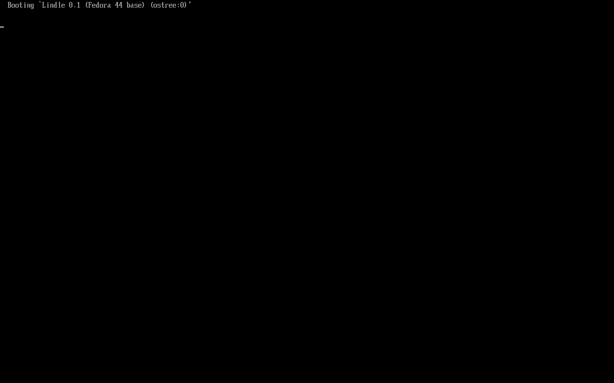
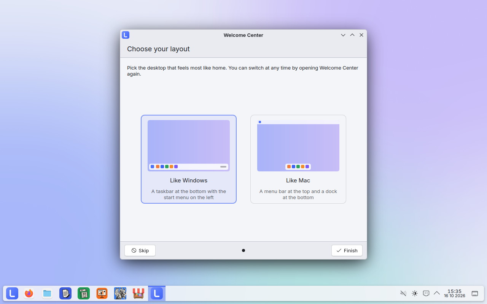
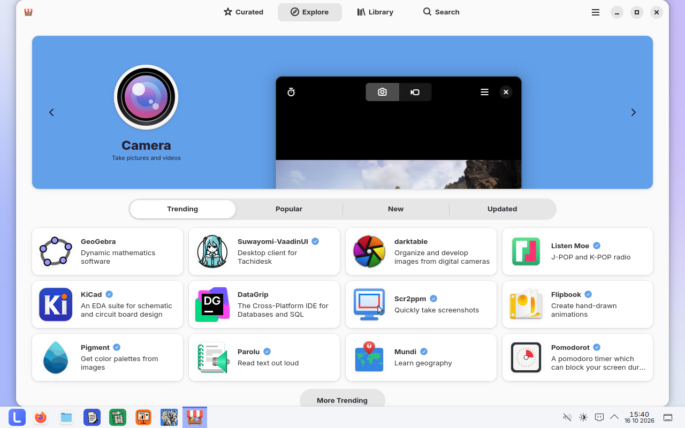
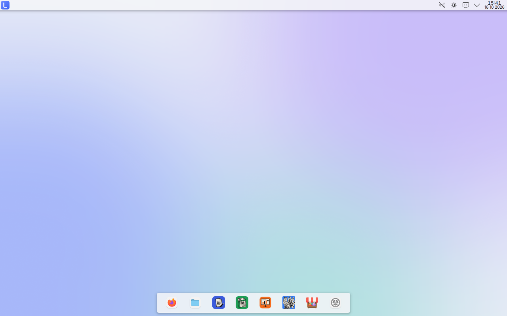
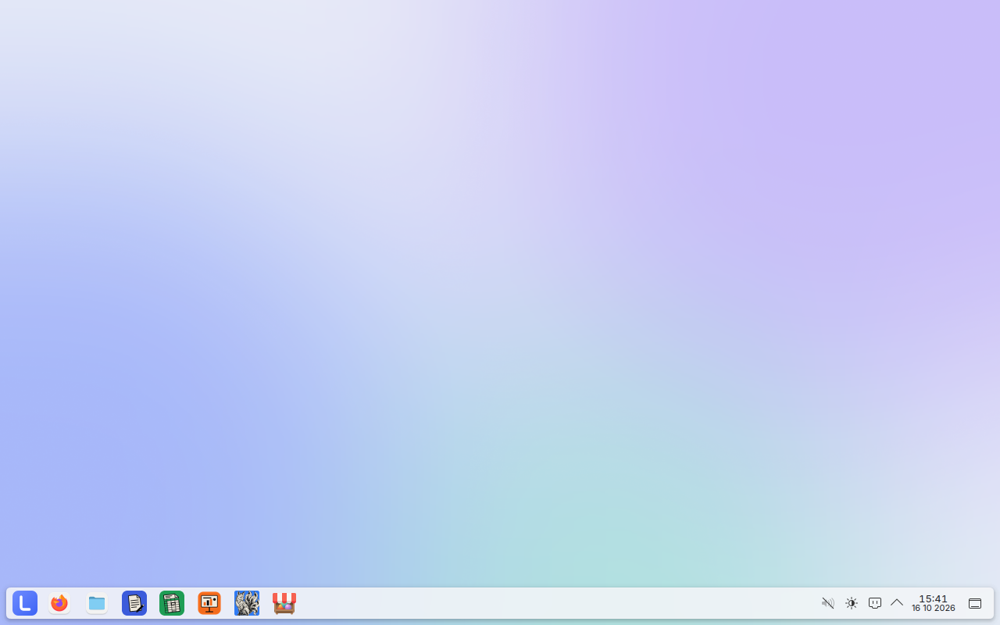

# Lindle screenshots

Taken automatically from `localhost/lindle:pr` by the Screenshots workflow.

## 00-boot-1

## 00-boot-2

## 00-boot-3

## 01-login

## 02-welcome

## 03-desktop

## 04-start-menu

## 05-welcome-apps

## 05a-welcome-layout

## 06-welcome-switching

## 07-wordcraft

## 08-gridcraft

## 09-photocraft

## 10-settings

## 11-app-store

## 12-layout-mac

## 13-layout-windows

