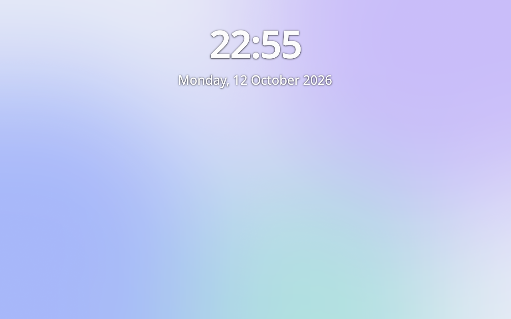
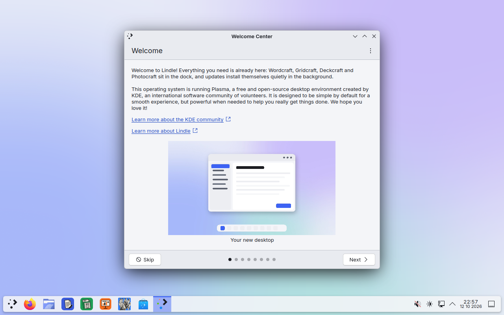
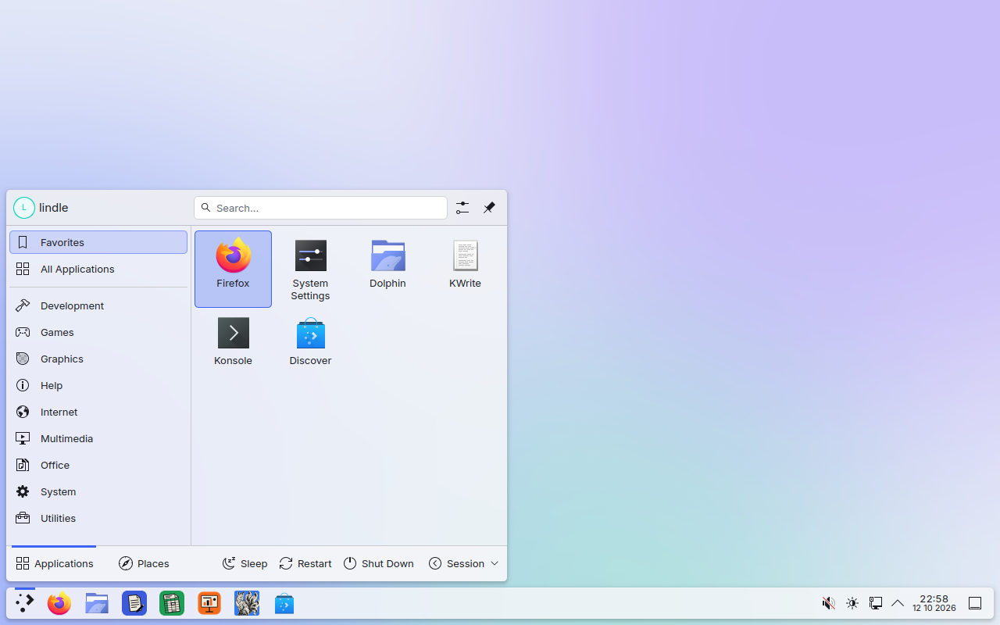
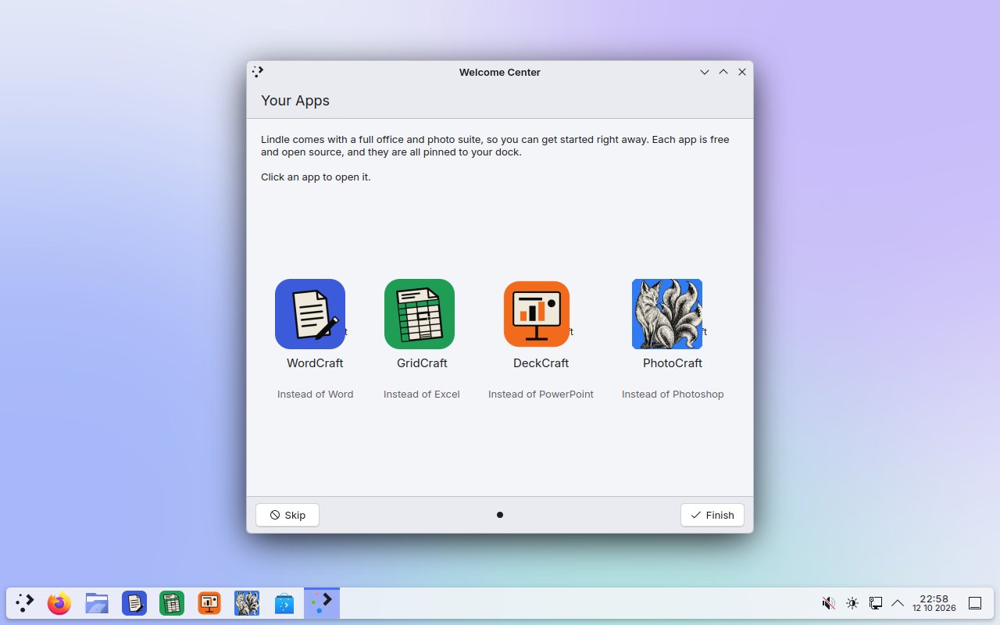
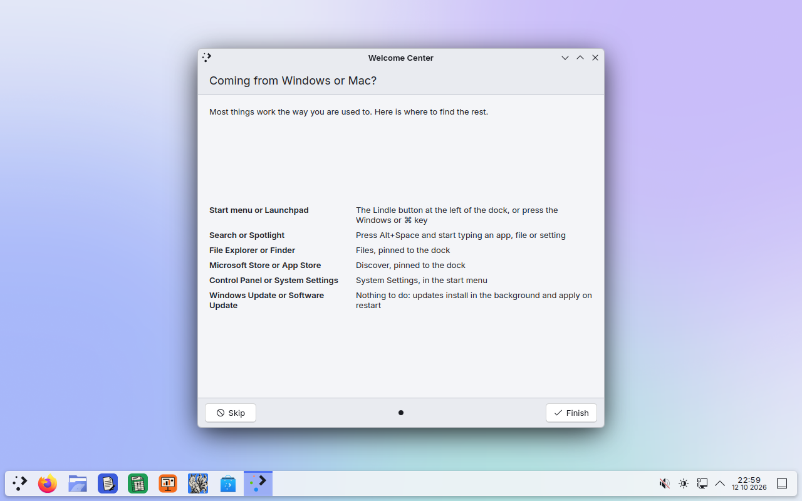
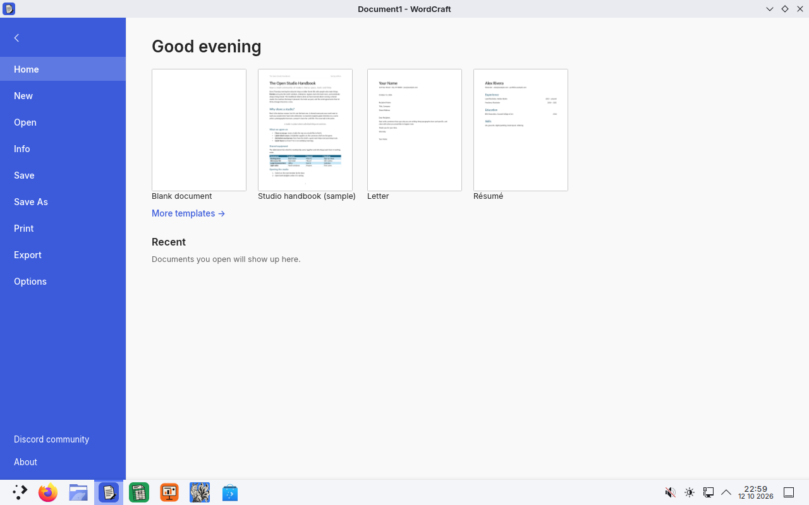
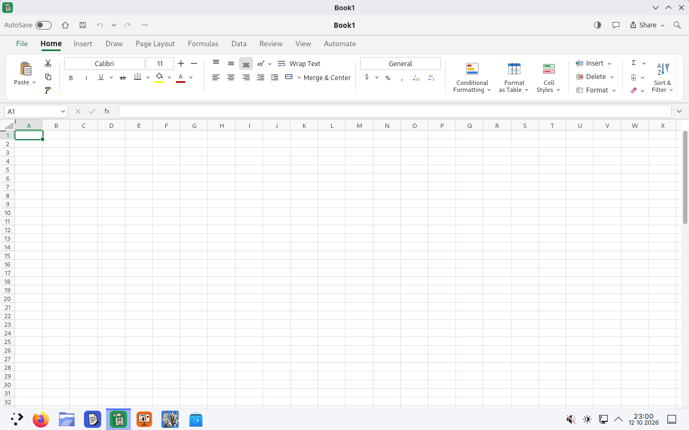
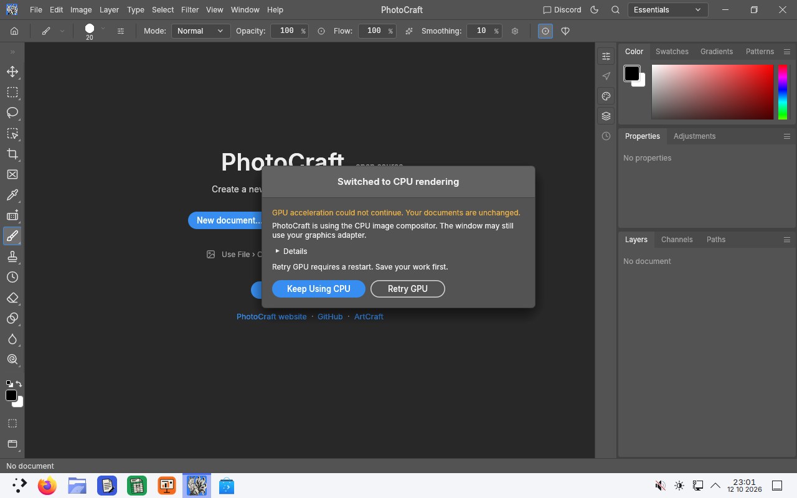
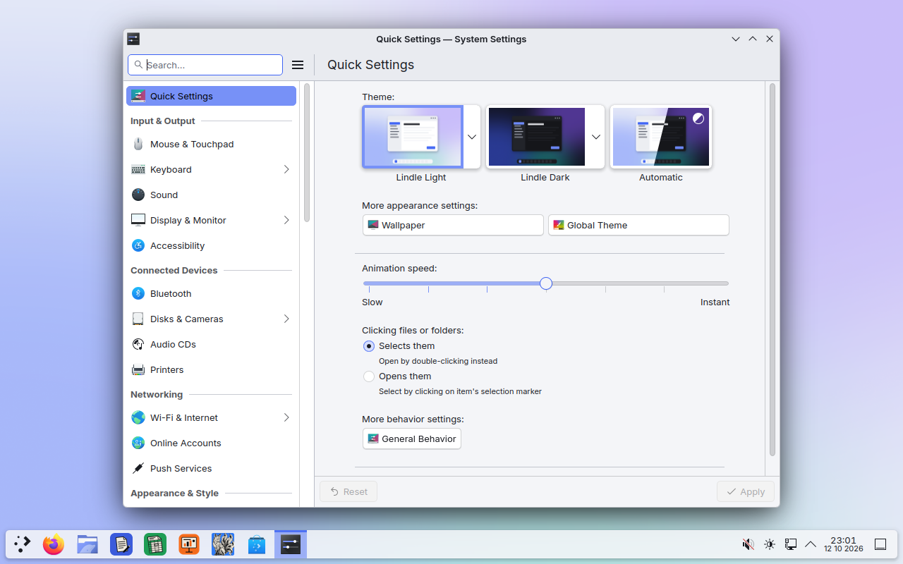

# Lindle screenshots

Taken automatically from `localhost/lindle:pr` by the Screenshots workflow.

## 01-login

## 02-welcome

## 03-desktop

## 04-start-menu

## 05-welcome-apps

## 06-welcome-switching

## 07-wordcraft

## 08-gridcraft

## 09-photocraft

## 10-settings

